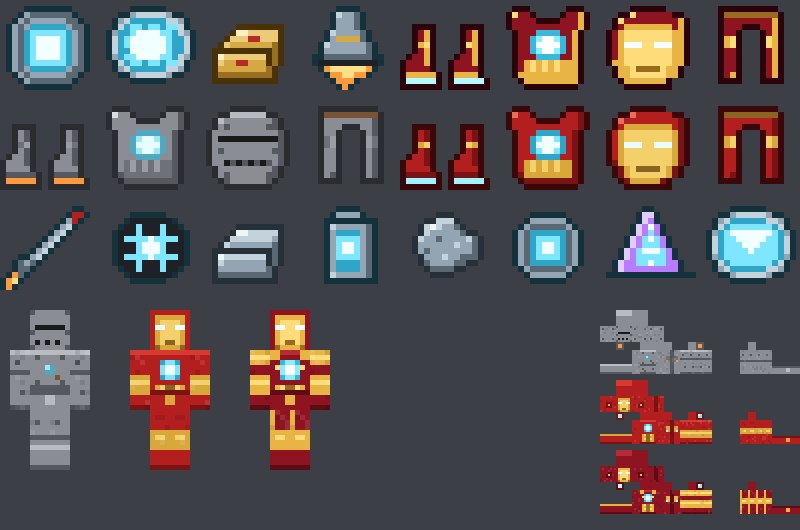

# Iron Man: Stark Industries

Мод для **Minecraft 1.21.11** (загрузчик **Fabric**), с которым можно стать Железным человеком.

В моде три модели костюма, дуговой реактор в груди, полёт с реактивным рывком,
репульсоры, юнибим, самонаводящиеся микроракеты и HUD Джарвиса в шлеме.



---

## Сборка

```bash
cd ironman
./gradlew build          # готовый jar: build/libs/ironman-1.0.0.jar
./gradlew runClient      # запустить игру с модом
```

Нужны **Java 21** и **Fabric API** (кладётся в `mods` вместе с модом).

Версии в `gradle.properties` взяты из веток `1.21.11` репозиториев FabricMC:

| Свойство | Значение |
|---|---|
| `minecraft_version` | 1.21.11 |
| `yarn_mappings` | 1.21.11+build.6 |
| `loader_version` | 0.17.3 |
| `fabric_version` | 0.141.6+1.21.11 |
| `loom_version` | 1.13.3 (Gradle 9.1) |

> **Честно о проверке.** В среде, где писался мод, закрыт доступ к
> `maven.fabricmc.net` и серверам Mojang, поэтому Gradle не может скачать
> Minecraft, и полную сборку там запустить нельзя. Взамен сделано следующее:
> * все Java-файлы разобраны компилятором `javac`: синтаксических ошибок нет;
> * каждый импорт, класс и метод Minecraft сверен с маппингами Yarn
>   `1.21.11` (например, `getEntityWorld()` вместо старого `getWorld()`,
>   новая система прав команд `requirePermissionLevel`);
> * каждый класс Fabric API сверен с исходниками Fabric API `0.141.6+1.21.11`;
> * все 127 JSON-файлов, текстуры и переводы проверены скриптом
>   `python3 tools/validate.py`.
>
> Если первая сборка всё же на чём-то споткнётся, скорее всего, это будет
> мелочь вроде имени звука или частицы: правка займёт одну строку.

---

## Как стать Железным человеком

1. **Палладий.** Палладиевая руда встречается в Верхнем мире на высотах от −64 до 56.
   Добывается железной киркой или лучше. Переплавьте её в слитки.
2. **Дуговой реактор Mk I** (железо, медь, редстоун, палладий). Возьмите
   в руку и нажмите **ПКМ**: реактор встанет вам в грудь. Реактор — источник
   энергии для любого костюма и переживает смерть.
3. **Mark I**: железо, палладий и реактивные сопла. Тяжёлый, медленный,
   вместо репульсоров стоит огнемёт.
4. **Mark III**: золото-титановый сплав, репульсорные узлы, а для нагрудника
   нужен нагрудник Mark I. Это классический красно-золотой костюм.
5. **Реактор Mk II → Старкиевый реактор**: больше ёмкость и быстрее зарядка.
6. **Mark 85**: каждая часть Mark III улучшается на кузнечном столе
   (шаблон незеритового улучшения + нанотехнологическое ядро).

Способности включаются, только когда надеты **все четыре части одной модели**
и в груди работает реактор. Для HUD и ночного зрения достаточно шлема.

### Управление

Все клавиши можно переназначить: «Настройки → Управление → Железный человек».

| Клавиша | Действие |
|---|---|
| **H** | Включить/выключить полётные системы |
| двойной **Пробел** | Взлёт (когда полёт включён) |
| **Пробел / Shift** | Вверх / вниз в полёте |
| **W + Бег (Ctrl)** | Реактивный рывок вдоль взгляда: хоть в небо, хоть в пике |
| **R** | Репульсор (у Mark I огнемёт). Если держать, стреляет очередью |
| **G** | Юнибим: луч из реактора, пробивает всех на линии |
| **V** | Залп самонаводящихся микроракет |
| **N** | Ночное зрение шлема |
| **J** | Показать/скрыть HUD Джарвиса |

### Модели костюма

| | Mark I | Mark III | Mark 85 |
|---|---|---|---|
| Броня (шлем/нагр./поножи/бот.) | 3/7/6/2 | 3/8/6/3 | 4/9/7/4 |
| Прочность брони (toughness) | 1 | 2,5 | 4 |
| Основное оружие | огнемёт, 4 урона + поджог | репульсор, 8 | репульсор, 12 |
| Юнибим | — | 20 урона | 32 урона |
| Микроракеты за залп | — | 4 | 8 |
| Скорость рывка | 16 блоков/с | 32 блока/с | 44 блока/с |
| Расход энергии | ×1,6 | ×1,0 | ×0,6 |
| Особое | тяжёлый: замедляет на земле | — | герметичен: иммунитет к огню, дыхание под водой |

Костюм гасит урон от падения за счёт энергии реактора.

### Дуговые реакторы

| Реактор | Ёмкость | Зарядка |
|---|---|---|
| Mk I | 1000 | 30/с |
| Mk II | 2500 | 60/с |
| Старкиевый | 6000 | 140/с |

Реактор заряжается сам, когда костюм 1 секунду не тратит энергию.
Палладиевая батарея мгновенно добавляет 800 энергии.

Что сколько стоит (до множителя модели): зависание стоит 1,5 энергии за тик,
рывок добавляет расход в зависимости от скорости; репульсор стоит 60,
огнемёт 45, юнибим 700, каждая ракета 60.

### HUD Джарвиса

Появляется, когда надет шлем:
* рамка визора и прицел в цвете модели;
* статус костюма (в сети / нет реактора / нет энергии / сколько частей надето);
* сегментированная полоса заряда реактора;
* полёт: статус, высота, скорость и курс;
* оружие: назначенные клавиши, готовность и перезарядка, число ракет;
* анализ цели на расстоянии до 64 блоков: имя, здоровье, дистанция, враг или нет;
* мигающее предупреждение о низком заряде.

### Команды

| Команда | Что делает |
|---|---|
| `/ironman status` | Показывает реактор, заряд и модель костюма |
| `/ironman suit <mark_i\|mark_iii\|mark_85>` | Надеть полный костюм и поставить реактор (нужны права оператора) |
| `/ironman reactor <none\|mk_i\|mk_ii\|starkium>` | Установить реактор (права оператора) |
| `/ironman energy <число>` | Задать заряд (права оператора) |

### Достижения

«Stark Industries» → «Доказательство, что у меня есть сердце» →
«Собрал в пещере» → «Я — Железный человек» → «Новый элемент» → «Я — неизбежность».

---

## Как устроен код

```
src/main/java/net/ironman/
├── IronMan.java                точка входа
├── suit/
│   ├── SuitTier.java           три модели костюма и все их числа (баланс — здесь)
│   ├── ReactorTier.java        реакторы: ёмкость и зарядка
│   ├── ReactorData.java        данные игрока (attachment Fabric, переживает смерть)
│   ├── Suit.java               «какой костюм надет»
│   ├── SuitManager.java        серверный тик: энергия, полёт, пассивные системы
│   └── Weapons.java            репульсор, огнемёт, юнибим, ракеты
├── entity/MicroMissileEntity   самонаводящаяся ракета
├── item/                       части костюма, реактор, батарея
├── registry/                   регистрация предметов, блоков, брони, урона, событий
├── net/                        пакеты клиент ↔ сервер
├── command/                    /ironman
├── world/                      генерация палладиевой руды
└── client/
    ├── JarvisHud.java          HUD шлема
    ├── FlightController.java   реактивный рывок (движение считает клиент)
    ├── IronManKeys.java        горячие клавиши
    └── IronManTooltips.java    подсказки предметов
```

Как устроен полёт. Пока полётные системы включены, сервер выдаёт игроку
ванильное право летать со скоростью модели костюма. Поэтому ванильный
античит не выкидывает летящего игрока, `allow-flight` на сервере включать
не нужно, а управление привычное. Рывок добавляет клиент, сервер списывает
энергию по фактической скорости. Если энергия кончилась или костюм сняли,
право полёта забирается. Его забирают и при выходе игрока, а метка в данных
игрока страхует от аварийного выключения сервера.

Ресурсы генерируются скриптами, руками правятся только переводы в `tools/lang/`:

```bash
python3 tools/gen_textures.py   # все текстуры (Pillow не нужен)
python3 tools/gen_data.py       # модели, рецепты, добыча, теги, генерация, урон, достижения
python3 tools/validate.py       # проверка, что Java и ресурсы сходятся
python3 tools/preview.py docs/preview.png
```
